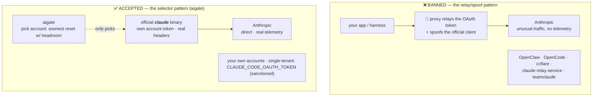
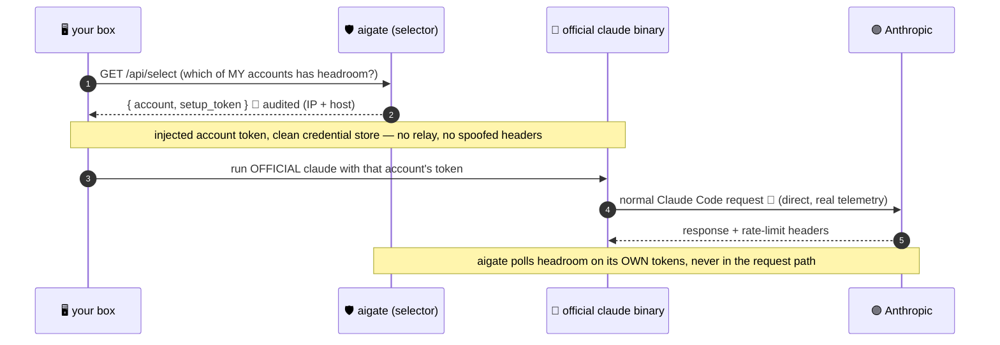
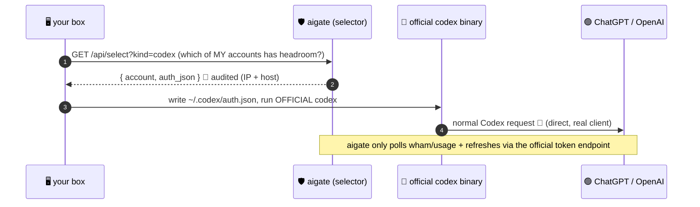

# ⚖️ aigate — Compliance

### *Multi-account Claude, the way Anthropic says is allowed — with receipts.*

---

> [!IMPORTANT]
> **The one rule that decides everything: *who makes the request?***
> A third-party harness that **spoofs** the official client with your subscription token → **banned.**
> The **real `claude` binary**, running **your own** accounts → **accepted.**
> **aigate is architected to always be the second thing.** For Claude it is a *selector*, never a proxy — it picks which account's token the *official* binary launches with, then gets out of the way. It is **never in Anthropic's request path**.

---

## 🧭 TL;DR

| ✅ aigate does | ❌ aigate never does |
|---|---|
| Runs the **official `claude` binary** | Spoof / impersonate the Claude Code client |
| Balances **your own** accounts by real headroom | Route requests **on behalf of other users** |
| Injects the picked account's token into the **official client** (clean credential store, no shadow login) | Extract tokens to feed a third-party harness |
| Stays **single-tenant** (just you) | Resell / share access, or pool for a team |
| Runs the **official `codex` binary** on **your own** ChatGPT logins | Relay Codex/ChatGPT traffic, or sit in its request path |
| Uses a real proxy **only for API-key providers** (OpenAI, fal, …) | Proxy/relay **Claude or ChatGPT subscription OAuth** |

If you can't say "these are **my** accounts and **I'm** the only user," you're outside what this doc covers — use an [API key](https://platform.claude.com/) instead.

---

## 🚧 The line, drawn

**Anthropic's enforcement targets exactly two things:** (1) **reselling or sharing** accounts, and (2) **harnesses that spoof the official client** — forged headers, no telemetry ([their eng's own words](https://x.com/trq212/status/2009689809875591565)). aigate does **neither**: it never resells or shares, and it runs the *real* `claude` binary, so there are **no forged headers** and Anthropic sees normal, honest telemetry.

---

## ✅ The three tests aigate passes

| Test | ❌ Banned tools | ✅ aigate |
|---|---|---|
| **Who makes the request?** | a proxy spoofing the client | the **official `claude` binary** |
| **Whose accounts?** | routes on behalf of *other users* / resells | **only your own** |
| **Evading limits?** | sharding one workload to dodge caps | picks headroom for *ordinary individual use* |

---

## 📜 What Anthropic actually says (verbatim)

From Anthropic's **[Claude Code — Legal & Compliance](https://code.claude.com/docs/en/legal-and-compliance)** page:

> "OAuth authentication is intended exclusively for purchasers of Claude Free, Pro, Max, Team, and Enterprise subscription plans and is designed to support **ordinary use of Claude Code and other native Anthropic applications**."

> "Anthropic does not permit third-party developers to offer Claude.ai login or to **route requests through Free, Pro, or Max plan credentials on behalf of their users**."

> "Advertised usage limits for Pro and Max plans assume **ordinary, individual usage** of Claude Code and the Agent SDK."

**Read closely:** the prohibition is scoped to developers routing subscription credentials **on behalf of *their users*** — i.e. serving *other people*. Running the official binary on your *own* accounts, as the *only* user, is the "ordinary, individual usage" lane. aigate is built to stay in it.

---

## 📎 Receipts — the primary sources

| Source | What it establishes | Verified |
|---|---|---|
| ⚖️ [Anthropic — Claude Code Legal & Compliance](https://code.claude.com/docs/en/legal-and-compliance) | The authoritative policy (quotes above). | ✅ fetched live |
| 🐦 [Thariq Shihipar (@trq212), Claude Code @ Anthropic — Jan 9, 2026](https://x.com/trq212/status/2009689809875591565) | Names the **banned** pattern: *"we tightened our safeguards against **spoofing the Claude Code harness** … third-party harnesses using Claude subscriptions … are **prohibited** by our Terms of Service."* aigate runs the real binary — no spoofing. | ✅ thread confirmed |
| 🐦 [Thariq Shihipar — Feb 19, 2026](https://x.com/trq212/status/2024212378402095389) | *"Nothing is changing about how you can use the Agent SDK and MAX subscriptions."* | ⚠️ via 2 write-ups |
| 🗞️ Anthropic → The New Stack (Feb 2026) | *"Nothing changes around how customers have been using their account and Anthropic **will not be canceling accounts**."* | ⚠️ press-reported |
| 🧩 [anthropics/claude-code #261](https://github.com/anthropics/claude-code/issues/261) · [#33430](https://github.com/anthropics/claude-code/issues/33430) | Anthropic's **own repo** treating **multiple accounts on one machine** (and per-account `CLAUDE_CONFIG_DIR` isolation) as an ordinary, supported setup. | ✅ primary repo |

> [!NOTE]
> **On the ⚠️ rows:** the two tweet/press items are cross-referenced from multiple independent write-ups citing the exact URL + quote, but X blocks automated fetching, so we can't machine-verify them the way we did the legal page and the Jan 9 thread. Treat the ✅ rows as load-bearing; the ⚠️ rows as strong corroboration. If any link rots, open an issue — this file is meant to stay true.

---

## 🛡️ How aigate stays on the accepted side (mechanically)

- **Official binary, always.** aigate hands a token to the real `claude` client. It never crafts, spoofs, or relays a request to `api.anthropic.com` on Claude's behalf.
- **The picked account actually serves.** aigate injects the chosen account's token via `CLAUDE_CODE_OAUTH_TOKEN` into the official client and keeps the credential store clean of any stale/competing login — so the account you *picked* is the account that *serves*, with no cross-account bleed. (Anthropic also blesses per-account [`CLAUDE_CONFIG_DIR`](https://github.com/anthropics/claude-code/issues/261) isolation if you'd rather use that.)
- **Your accounts only.** Tokens are stored AES-256-GCM encrypted and only ever handed back to *your* boxes. No third party, no other users.
- **Honest telemetry.** Because it's the real client, Anthropic sees normal usage patterns — the *opposite* of the "unusual traffic without telemetry" that triggers enforcement.

---

## ⚠️ Where *you* could still cross the line (respect this)

aigate keeps the **architecture** compliant; it can't stop you from **using** it in a banned way. Don't:

| ❌ Don't | Why |
|---|---|
| Shard one heavy 24/7 workload across N accounts to beat the weekly cap | **Limit evasion** — bannable *even with the official binary* |
| Ship a token to a machine used by a **different person** | Crosses into "on behalf of another user" |
| Point aigate's Claude path at a relay/proxy | That's the spoofing pattern; keep the **no-relay-for-Claude guardrail sacred** |
| Resell or share account access | Explicit ToS violation, instant ban |
| Over-drain a subscription for API-grade work | Prefer an **API-key fallback** (Console pay-go) |

**When in doubt:** if the work is programmatic/heavy or another human benefits, use an **[API key](https://platform.claude.com/)** — it's the sanctioned path and it's what aigate's roadmap proxy is *for* (API-key providers only).

---

## 🧠 The Codex (ChatGPT) half

Codex accounts follow the **same selector pattern** as Claude: aigate is a vault and a picker, **never a relay**. The official `codex` binary makes every request to ChatGPT itself, with its own headers and telemetry; aigate is not in that path.

| ✅ aigate does (Codex) | ❌ aigate never does (Codex) |
|---|---|
| Stores **your own** ChatGPT logins (`auth.json`) AES-256-GCM encrypted | Hold, share, or hand out logins that are not yours |
| Writes the picked account's **`auth.json`** for the **official `codex` binary** to read | Proxy, relay, or rewrite Codex's requests |
| **Reads `chatgpt.com/backend-api/wham/usage`** with the account's own token to learn headroom | Send prompts or model traffic anywhere |
| **Refreshes tokens** through OpenAI's official token endpoint (`auth.openai.com/oauth/token`) using the **public Codex CLI client id**, the same call the binary itself makes | Mint tokens by any other route, or use a private or borrowed client id |
| Stays single-tenant: your boxes, your accounts | Resell, pool for others, or serve another person's session |

- **Official binary, always.** aigate's whole footprint on the client is one file, `auth.json`, written atomically with mode 600. A pre-existing login is backed up once (`auth.json.bak-pre-aigate-*`). The request path to ChatGPT never touches aigate.
- **Two server-side calls, both the client's own.** The usage read (`wham/usage`) and the token refresh are the calls the official client makes for itself; aigate makes them on your behalf for **your** accounts only, and does not follow redirects, since both carry live credentials.
- **Refresh late.** Rotating a refresh token orphans every other holder of that login (such as the Codex desktop app), so aigate refreshes only when the access token is near expiry (default: within four days, `AIGATE_CODEX_REFRESH_AHEAD_S`). A client whose own login rotated can sync the newer one back with `POST /api/codex/sync`, and a per-box **keeper** (launchd every 5 minutes on macOS, a `systemd --user` timer or cron on Linux) pulls the vault's current login via `GET /api/codex/auth` so a long-lived codex never spends a token the vault already rotated. While a codex process is live, `ai codex` keeps its on-disk account instead of switching it.
- **Honest identity.** The usage read identifies itself as `aigate/<ver> (codex-usage)`; it does not pose as the Codex client. The refresh call sends the public Codex CLI `client_id` because OAuth requires the refresh to come from the client the tokens were issued to; that is a protocol requirement, not a disguise, and the call sends no fake user-agent.
- **If a refresh outcome is uncertain, aigate stops.** Only errors that provably happened before the request was sent are retried; anything else halts auto-refresh (`refresh_unknown`) rather than risk spending a single-use token twice. A ledger kept outside the database (`codex-ledger.json`) makes a restored backup halt the same way instead of replaying a spent token.
- **Your accounts only.** The same single-tenant rule as Claude applies. Don't spread one heavy workload across many ChatGPT accounts to beat limits, and don't put a login on a machine used by someone else.
- **Policy status is yours to check.** Unlike the Claude section above, this document quotes no OpenAI policy and makes no claim that a given ChatGPT plan permits multiple personal accounts. Read OpenAI's current terms for your plan. What aigate guarantees is the architecture: official binary, your own logins, no relay.

### 🖥️ Desktop apps

- **ChatGPT/Codex desktop:** `ai desktop codex` only writes `auth.json` and restarts the app, which reads that file itself.
- **Claude Desktop:** **display-only.** aigate can show which account it recommends but does not inject anything into the app, and cannot: the app launches its Code runtime with its own signed-in credential. Nothing here works around or overrides the app's own login.

### 🧹 CLIProxyAPI is gone

Earlier Codex routing went through CLIProxyAPI, a local OAuth-pooling proxy. That component has been **removed and is no longer used**: the installer retires the `aigate-gpt.sh` shim, and Codex goes directly through the official binary via `aigate-codex.sh`. No proxy sits between your machine and ChatGPT any more.

---

## 🧪 The prompt API

`POST /api/prompt` (plus `GET /api/models`) is a **prompt-in, answer-out HTTP service that runs on your subscription credentials**. A caller sends text; aigate picks one of your vaulted accounts, spawns the official `claude` or `codex` binary with that account's login, and returns what the binary printed. Unlike the rest of aigate it is not a hand-out of a credential to a person's own machine: the request, and the answer, travel through aigate. Read it as that, not as "the same selector pattern".

- **Only the official binaries.** aigate never calls `api.anthropic.com` or ChatGPT with a subscription credential itself and never crafts or forwards those requests. A missing binary is a `503`; there is no direct-request fallback.
- **Off by default.** The routes do not exist unless the operator sets `AIGATE_PROMPT_API=1`; otherwise they answer like any unknown path (`404`).
- **Who can use it.** The credential that unlocks it is the shared `AIGATE_TOKEN` (`Authorization: Bearer`; dashboard sessions and `x-api-key` are refused). There is no per-caller identity, so **anything or anyone holding that token can run prompts on your subscriptions**, and everything it can already do to the vault it can do here. It is for the owner's own automation, not for other people, teams or customers.
- **A deliberate risk decision.** This is programmatic, unattended use of subscription accounts. A provider may treat that differently from a person at a keyboard, and aigate cannot tell you where the line is. Turning the flag on is the owner's own decision and risk.
- **What the model can and cannot do.**
  - *Claude:* every built-in tool is removed (`--tools ""`), permissions are `dontAsk` with prompts disabled, MCP, slash commands/skills, session files and Chrome are off.
  - *Codex:* it has no tool-free flag. The runner passes `--disable` for every tool-bearing or ambient feature the installed binary lists (shell, unified exec, apps, plugins, browser/computer use, image tools, multi-agent, hooks, skills search, daemon auto-start and others), sets `web_search="disabled"`, uses a **read-only sandbox**, `--ephemeral`, and ignores user config and rules. **Not everything can be turned off**: on codex 0.167.0, for example, `unified_exec` stays effectively on after `--disable`. The startup log and `GET /api/models` (`codex_surface.still_on`) list what is still on for the installed binary. A read-only sandbox can still read files the server user can read.
  - *The control that actually holds:* the runner reads Codex's event stream and **fails closed**. Any item other than an agent message, reasoning or an error (command execution, MCP call, file change, web search, anything new) makes the run a `502 tool use detected`, and the text is discarded and never returned. The run has still executed whatever it did before being refused.
  - The Codex login sits in a directory the model's working directory does not contain, but a read-only sandbox does not prevent reading it if a tool ran; the parser refusal and the redaction below are the mitigations, not isolation.
- **One Codex run per account.** At most one Codex run holds an account's refresh token at a time (a second gets `429`); aigate's own refresh is skipped for that account while it runs, and a login too close to expiry for the run is refreshed first. Claude runs have no such per-account limit; total runs are capped by `AIGATE_PROMPT_CONCURRENCY`. A login the binary rotated during a run is stored back through the same path as `/api/codex/sync`; if it cannot be stored the account is marked refresh-unknown (alerting), the file is kept and re-offered at the next boot.
- **Plumbing.** The prompt goes to the binary on stdin and the system prompt (Claude) in a file in a private `0700` run directory, never in argv; the child gets an allowlisted environment (never the vault key or admin token) and its own throwaway home; the process group is killed on timeout; a Claude run is killed when its client disconnects, a Codex run is not.
- **What the audit does and does not scrub.** The dashboard and `request_log` get the first 400 characters of the prompt, passed through aigate's prefix-based secret scrubber (it catches `sk-…`, `ghp…` and similar shapes, **not** arbitrary secrets you type into a prompt). The system prompt, the full prompt, the answer and every credential are never logged. Responses have the run's own credentials removed by exact value; other secrets the model might know are not touched.
- **Heavy or multi-user work belongs on API keys.** Anything high-volume, spread across accounts to get around a weekly cap, or done for another person must use an [API key](https://platform.claude.com/) (aigate's `/v1` proxy exists for exactly that), not this endpoint.

---

## 🔀 The non-Claude half (API keys are different)

The prohibition above is about **Claude subscription OAuth**; the same no-relay rule is kept for ChatGPT subscription logins. Ordinary **API keys** (OpenAI, OpenRouter, Gemini, Groq, fal, …) are *meant* for programmatic use — so aigate's **secure proxy** (`POST /v1/messages`, `GET /v1/models`) injects those server-side freely. That's a normal API gateway and carries none of the subscription-OAuth restrictions.

The proxy is structurally incapable of crossing the line above: it reads only from the API-key registry (`provider_keys`), never from the Claude-account vault (`accounts`) — the two tables, two code paths never touch. A key that *looks* like a Claude Code setup-token (`sk-ant-oat…`) is refused both at store-time (vaulting it under the `anthropic` provider 400s, telling you to add it as an account instead) and at fetch-time (a poisoned row that slipped in some other way is skipped, audited, and the next real key is tried) — so even a mistake can't relay a subscription token through this path.

| Provider type | aigate mode | In the request path? | Compliance |
|---|---|---|---|
| **Claude subscriptions** (OAuth) | 🎯 Selector — official binary | ❌ never | ✅ accepted architecture |
| **Codex / ChatGPT logins** | 🎯 Selector — official `codex` binary; aigate writes `auth.json`, reads `wham/usage`, refreshes via the official token endpoint | ❌ never | ✅ same no-relay architecture; plan terms are yours to check |
| **API-key providers** | 🔀 Secure proxy — `openrouter`, `kimi`, `anthropic` (API keys only) | ✅ standard | ✅ normal for API keys |

---

**⚖️ Personal · honest · visible.** Multiple *personal* subscriptions via the official client is fine — pooling or reselling for others is not. aigate exists to give you the visibility to stay honest. 🛡️

*Found a link that rotted, or a policy that changed? [Open an issue](https://github.com/shoemoney/aigate/issues) — compliance docs are only useful if they stay true.*

